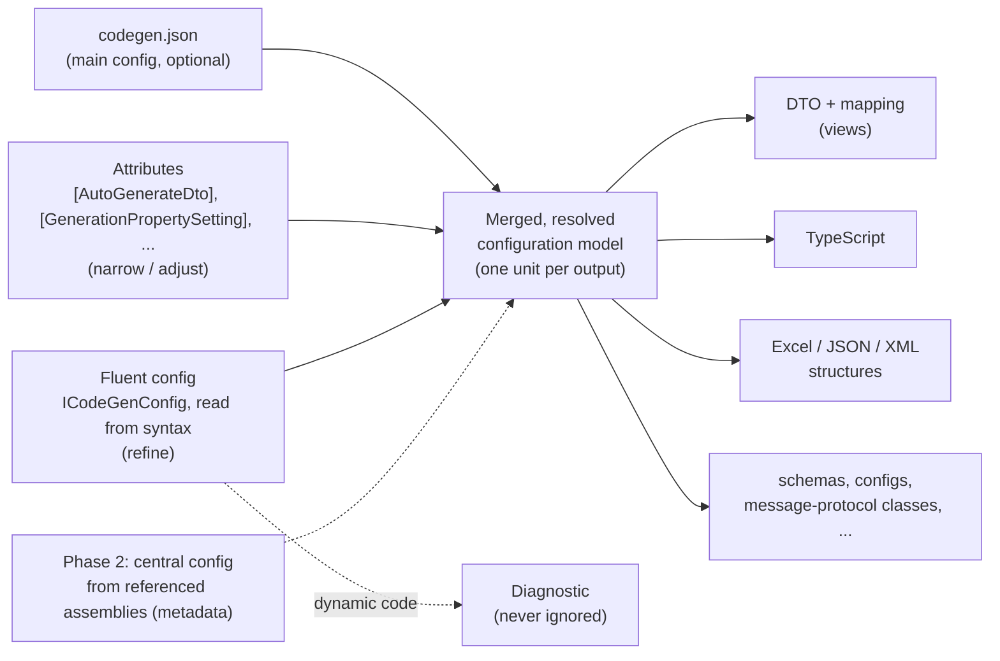
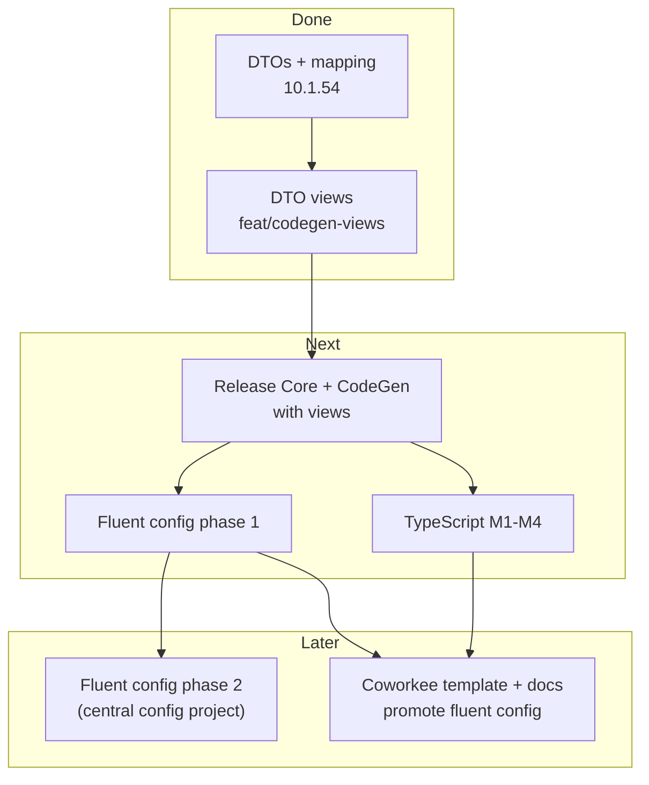

# Nextended.CodeGen roadmap

Progress file for the work on `Nextended.CodeGen`, kept so the work can continue from this repository in a later session.
Update the status tables when a milestone moves.

## Goal

`Nextended.CodeGen` becomes the central, configurable class generator that CargonerdsApp, CoShipee and other apps use, documented on the
Nextended site and shown in Coworkee (whose apps generate their DTOs with it):

- **DTOs** from entities: done; the gaps found by CoShipee were fixed in 10.1.54.
- **Several DTO views per entity**: done on branch `feat/codegen-views` (see below).
- **TypeScript generation**: to be reimplemented cleanly (see below).
- **A fluent configuration** next to `codegen.json` and the attributes: the owner's vision, written down below.

Binding rules for every step:

- Backward compatible with the CargonerdsApp exactly as it is. Proof: pack locally, point CargonerdsApp's `Nextended.CodeGen`
  `PackageVersion` at it, build the generating project (`modules/hub/src/Hub.Domain`), the generated files must be byte-identical;
  revert. (Use a temporary `git worktree` of CargonerdsApp when its checkout is busy.)
- The golden test (`Tests/Nextended.CodeGen.Tests/SampleGoldenTests`, regenerates `Tests/TestProjects/CodeGenSample`) stays green with only
  intended additions.
- New settings or attributes only when no existing feature covers the need; new behaviour is opt-in.
- Docs (`docs/projects/codegen.md`, `docs/de/projects/codegen.md`, `Nextended.CodeGen/README.md`) describe every way a feature is used.

## Status

| Milestone | Status | Where |
| --- | --- | --- |
| DTO generation, mapping (extensions, Mapperly), 10.1.54 gaps | done, released 10.1.54 | `main` |
| DTO views (multiple `[AutoGenerateDto]` per type) | done, not released | branch `feat/codegen-views` |
| TypeScript generation | to redo (M1-M4 below) | old attempt: `origin/feat/typescript-gen` (ab125d1) |
| Fluent configuration, phase 1 (same assembly) | designed, in progress | branch `feat/codegen-fluent`, design: `docs/projects/codegen-fluent-design.md` |
| Fluent configuration, phase 2 (central config project) | idea | |
| Coworkee: views and fluent config shown in the template and docs | open | CoworkeeLib |

### DTO views — done (branch `feat/codegen-views`)

- [x] The first `[AutoGenerateDto]` is the default DTO (unchanged output); every further one is a view, keyed by its required `GeneratedClassName`.
- [x] Views are flat (inherited members, no base DTO), concrete, with their own `Namespace`, `PropertiesToIgnore`, mapping settings, file.
- [x] `AutoGenerateDto.PropertyNames` (`"Source=Dto"`, inherited members too), `AutoGenerateDto.UseViews` (member types switch to a view,
      also via a base type: shared views such as `HubCodeDto` on `CodeEntity`), `AutoGenerateDto.OutputPath`.
- [x] `GenerationPropertySetting.View` (attribute now `AllowMultiple`): a setting for one view replaces the general one there.
- [x] Mapping per view: `To<ViewClass>()`, extensions and Mapperly (`<ViewClass>Mapper`); reverse skipped where the view cannot create the source.
- [x] Diagnostics `NCG010`-`NCG014` (view without name, name taken, mapping method taken, unknown view key, bad `PropertyNames` entry).
- [x] New settings are read from the attribute data by name: the generator works with the released Nextended.Core (it references the
      package, `UsedCorePackageVersion`), tests compile against the in-tree attribute sources (`TestCompilation.CompileWithInTreeAttributes`).
- [x] Tests: `DtoViewTests` (9, the ABP quotation use case end to end incl. JSON and Mapperly), all 28 tests of the project green.
- [x] Golden: CodeGenSample gained the `AddressLine` view (2 new files, all others unchanged). CargonerdsApp Hub.Domain: 181 generated files
      byte-identical (13 more files in its `Generated` folder are stale leftovers that neither 10.1.50 nor the branch generates).
- [x] Docs EN/DE + README.
- [ ] Release: Nextended.Core first (it declares the new attribute properties), then raise `UsedCorePackageVersion` so the sample and the
      generator see them; the sample can then show `PropertyNames`/`UseViews` too.
- [ ] CoShipee: replace the hand ABP DTOs (`QuotationDto`, `HubPortDto`, `HubCodeDto`, ...) with views (`docs/dto-generation.md` there lists them).

### TypeScript generation — to redo

Assessment of `origin/feat/typescript-gen` (ab125d1, "feat: ts-gen", ~520 lines, no tests): **reimplement on `main`, do not rebase**
(keep at most its `ToTsType` switch as a reference).

- Blocker in the branch: without a `Typescript` config section it `AddSource`s TypeScript as C# (`X.g.ts.cs`) → `CS8802`, which would break
  every consumer, CargonerdsApp included.
- Gaps: enum values dropped (positional), `[Flags]`/string enums ignored; `JsonPropertyName`/`JsonIgnore`/`PropertyName` renames ignored;
  walks entities instead of the real DTOs (misses partials and hand DTOs); `IReadOnlyDictionary`/`KeyValuePair` broken; `ForceMapping`
  misses types used only in `List<T>`; flat folder (name collisions); no barrel, no header; not incremental; stale files never deleted;
  `Environment.NewLine` line endings.
- Frontends today: CargonerdsApp `frontend/realtime` uses ~24 hand-written `src/types/*.ts` (interfaces, `T | null`, `string` for Guid
  and dates, numeric enums because ABP sends numbers, odata-query against OData sets that are not in Swagger); CoShipee reuses that FE via
  AbpCompat; Coworkee's `typescript/client` is generated with openapi-typescript.
- Plan: target the types OpenAPI does not cover (OData sets, SignalR payloads, client-DB rows, enums, permission names). Off by default
  (`Typescript` list with required `OutputPath`, never `AddSource`). Select real compiled types in the contracts (+ optional DTO-model path).
  Follow the serializer: camelCase, `JsonPropertyName`/`JsonIgnore`, enums as numbers or strings per preset (ABP / Coworkee), explicit
  values, dictionary enum keys as name unions. Mapping table (`long`/`decimal` → `string` option, `byte[]` → `string`, `object` →
  `unknown`, dictionaries → `Record`, `KeyValuePair` → `{ key; value }`, user type map e.g. `PagedResultDto<T>`). Nullability → `| null`,
  optional `?` by option. Interfaces `extends` without repeating members, `[JsonPolymorphic]` → discriminated unions. Namespace folders,
  relative `import type`, `index.ts` barrel, header, `\n` always, deterministic output, stale cleanup via a manifest. Incremental,
  equatable model. CI staleness check. zod later.

| TS milestone | Content | Estimate |
| --- | --- | --- |
| M1 | types, enums, nullability | ~1 day |
| M2 | inheritance, generics, unions, folder layout; `tsc --strict` in the tests | ~1 day |
| M3 | incremental, CI check, docs, presets | ~1 day |
| M4 | pilot: CargonerdsApp `Hub.Application.Contracts` against the hand `src/types`, then CoShipee | |

## Fluent configuration — the owner's vision

Today the configuration is `codegen.json` plus attributes; **both stay**. Added: a rich fluent class configuration, similar to
`Nextended.ResponseFilters`. An app implements e.g. `ICodeGenConfig` (or a typed `I...<T>`) and configures with `Configure<T>`-style calls:

```csharp
public sealed class ShipmentCodeGen : ICodeGenConfig
{
    public void Configure(ICodeGenBuilder gen)
    {
        gen.DtoGenConfigure<CalculatedShipment>(s =>
        {
            s.Id.Ignore();
            s.WhatEver.AsTarget("...");
        });
    }
}
```

What it must be able to do:

- change the behaviour of single properties (ignore, rename, retype, attributes, mapping);
- write additional output files, for one DTO or for all;
- per-assembly rules: assembly X generated differently from, or additionally to, assembly Y;
- usable for **all** generators: DTO, Excel, TypeScript, schemas, configs, message-protocol classes, ...

Precedence: **json** (main configuration, becomes fully optional) → **attributes** (narrow/adjust, as today) → **fluent** (refine).
The old behaviour stays; the new way is optional but promoted as the default way and shown in Coworkee. It gets docs and README on the
Nextended site, new samples linked from the docs, new tests and many edge cases.

### Chosen design (summary; full record in `docs/projects/codegen-fluent-design.md`)

- Typed base classes in `Nextended.Core` (namespace `Nextended.Core.CodeGen`), rules in the constructor, like `ResponseFilter<T>`:
  `DtoConfig<T>` for one entity, `CodeGenConfig` for defaults (`Defaults` = codegen.json), `Dto<T>()`, `Dto(typeof(Open<>))`,
  `IgnoreType<T>()`, `ForNamespace`, `ForAssembly`, `ExcelGeneration`, `StructureGeneration`.
- Member selectors (`Ignore(x => x.TenantId)`, `Property(x => x.Number).PropertyName("No")`) instead of the sketched `s.Id.Ignore()`
  (that needs an extension method on every type or a generated shape type the generator would have to read back).
- Settings are named 1:1 like the attribute/json property they mirror; extra operations: `Include`, `View`, `Order`,
  `BaseMembersFirst`, `Emit` (template file per DTO, or for all DTOs from `Defaults`).
- Read, never executed: the constructor body is walked with `IOperation` (constants, `nameof`, `typeof`, enum members, nested
  lambdas, selectors); anything dynamic is `NCG020`. Diagnostics `NCG020`-`NCG026`.
- Merge: json → fluent `Defaults` (still defaults) → attributes → fluent `ForNamespace` → fluent `Dto<T>`; member rules view → type →
  base types → namespace. Several profiles merge by full type name, conflicts warn (`NCG022`).
- Phase 2 (central config project): serialize the read spec into the config assembly, consumers merge it; needs the symbol-free spec.

### Design notes known so far

- A source generator cannot execute the configuration code. The fluent configuration is **read** from the syntax tree and the semantic
  model: allowed are member access lambdas (`s => s.Id`), constants, `typeof`/`nameof`, nested lambdas. Anything dynamic (a variable, a
  method call that computes a value, a loop) is reported as a diagnostic — never silently ignored.
- All three sources merge into **one resolved configuration model** before any generator runs; the generators read only that model.
  (The DTO views prepared this: `DtoUnit` is the per-DTO resolved unit; the fluent reader would produce the same units.)
- Phase 2, cross-assembly central configuration: a config project emits its resolved configuration as assembly metadata (e.g. an
  embedded resource or assembly attributes); consuming projects read it from their references.





## Open points

- From the CoShipee PoC on 10.1.55 (2026-11-11): (a) `PreClassString`/kept attributes of a member typed by a DTO class go onto the
  explicit interface implementation (`DtoCodeGenerator`: "gets its attributes on the explicit interface implementation below"), so JSON
  attributes such as `[JsonPropertyOrder]` have no effect there — should optionally go on the public property; (b) member order of views
  (fluent `BaseMembersFirst`/`Order`, see the fluent design); (c) BUG: `MappingExtensions.g.Dimension.HubDimensionDto.cs` writes
  `where TUnitDto : HubCodeDto` without namespace (a view type in a generic constraint is not fully qualified; CoShipee uses a global
  alias); (d) views with extra members (shadow keys like `QuotationId`) and member type changes (`Guid` → `Guid?` with a converter) —
  planned fluent operations `AddMember<T>`/`Property(...).Type<T>()`; (e) a view of an abstract type cannot merge members of several
  subtypes (`MarginPlaceDto`).

- DTO views: a member that maps through a view of a base type is skipped when mapping back (extensions); an include list for views
  (`Properties = [...]` instead of a long `PropertiesToIgnore`) does not exist; `[IgnoreOnGeneration]` cannot be undone for one view;
  a `PropertyNames` rename on a default DTO reaches only the members that DTO declares (inherited ones live in the base DTO).
- Shared views of unrelated entities (no common base) are not supported by design (`NCG011`); a shared base type is required.
- The CodeGenSample project builds against the published packages (`UsedCorePackageVersion`), so its checked-in files are produced by the
  golden test, not by building the sample.
