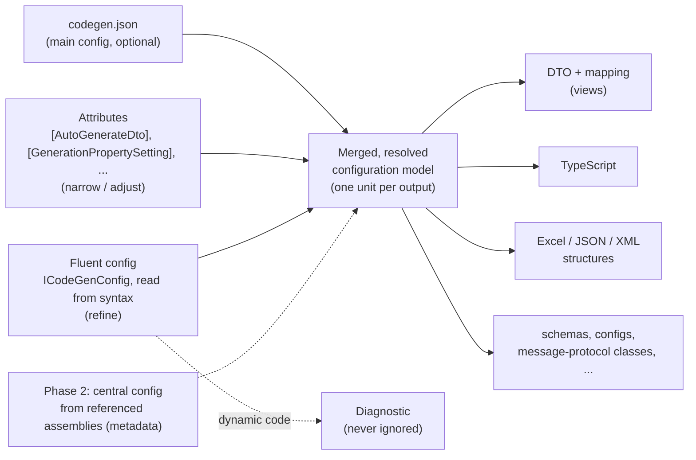
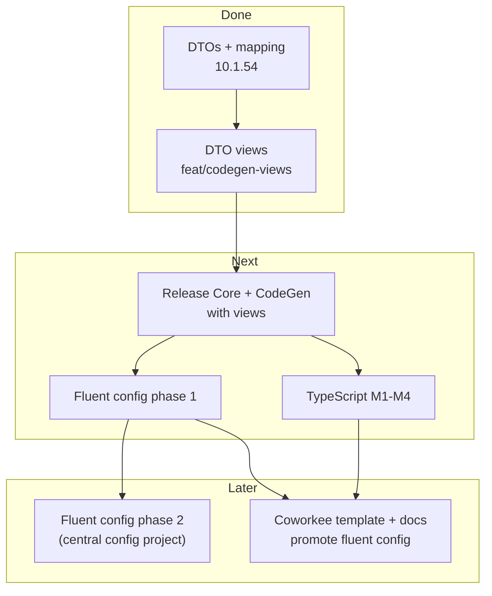

# Nextended.CodeGen roadmap

Progress file for the work on `Nextended.CodeGen`, kept so the work can continue from this repository in a later session.
Update the status tables when a milestone moves.

## Goal

`Nextended.CodeGen` becomes the central, configurable class generator that CargonerdsApp, CoShipee and other apps use, documented on the
Nextended site and shown in Coworkee (whose apps generate their DTOs with it):

- **DTOs** from entities: done; the gaps found by CoShipee were fixed in 10.1.54.
- **Several DTO views per entity**: done, released (see below).
- **TypeScript generation**: M1-M3 released; M4 pilot done in CargonerdsApp (branch `feat/ts-type-gen`, not merged), its gaps are
  closed in 10.1.60 (see below).
- **A fluent configuration** next to `codegen.json` and the attributes: phase 1 released (see below).

Binding rules for every step:

- Backward compatible with the CargonerdsApp exactly as it is. Proof: pack locally, point CargonerdsApp's `Nextended.CodeGen`
  `PackageVersion` at it, build the generating project (`modules/hub/src/Hub.Domain`), the generated files must be byte-identical;
  revert. (Use a temporary `git worktree` of CargonerdsApp when its checkout is busy.)
- The golden test (`Tests/Nextended.CodeGen.Tests/SampleGoldenTests`, regenerates `Tests/TestProjects/CodeGenSample`) stays green with only
  intended additions.
- New settings or attributes only when no existing feature covers the need; new behaviour is opt-in.
- Docs (`docs/projects/codegen.md`, `docs/de/projects/codegen.md`, `Nextended.CodeGen/README.md`) describe every way a feature is used.

## Status

| Milestone | Status | Where |
| --- | --- | --- |
| DTO generation, mapping (extensions, Mapperly), 10.1.54 gaps | done, released 10.1.54 | `main` |
| DTO views (multiple `[AutoGenerateDto]` per type) | done, released (≤ 10.1.59) | `main` |
| TypeScript generation (M1-M3) | done, released (≤ 10.1.59) | `main` |
| TypeScript M4 pilot (CargonerdsApp `frontend/realtime`) | done, not merged | CargonerdsApp branch `feat/ts-type-gen` |
| TypeScript gaps of the pilot (10.1.60) | done, not released | branch `feat/codegen-1060` (see below) |
| Fluent configuration, phase 1 (same assembly) | done, released (≤ 10.1.59) | `main`, design: `docs/projects/codegen-fluent-design.md` |
| Fluent configuration, phase 2 (central config project) | idea | |
| Coworkee: views and fluent config shown in the template and docs | open | CoworkeeLib |
| Qualified DTO names (constraints, base casts), mapping without `DeepProperties` | done, released (≤ 10.1.59) | `main` |
| Sub-generators per run (parallel compilations) | done, released 10.1.59 | `main` |

### 10.1.60 — gaps of the TypeScript pilot (branch `feat/codegen-1060`)

All opt-in; without the new settings the output is unchanged.

- [x] `Header` (generation; json, fluent `Header(...)`): own header text, `""` = none; default unchanged (`// <auto-generated>` +
      `/* eslint-disable */`). Finding: without the eslint line, ESLint 9 flags the empty `interface X extends Base {}` declarations
      (`no-empty-object-type`, 43 in the pilot), with it it reports unused directives; the pilot keeps the folder in the ESLint ignores.
- [x] `OptionalDefaultValues` (generation and per type, `bool?` on `Types`; fluent on both builders): members with an initializer other
      than `null`/`default` (also `!`), a record parameter default or `[DefaultValue]` are optional; `required`, `[Required]`,
      `[JsonRequired]` and `.Optional(false)` keep a member required.
- [x] `IncludeMembersWithAttributes` (generation and per type; fluent `IncludeMembersWithAttribute<T>()`/`IncludeMembersWithAttributes(...)`):
      only members carrying one of the attributes (full/simple name, `Attribute` optional; attributes on the entity of a generated DTO count);
      a type's list replaces the generation's (empty = off), `Property(...).Include()` brings a member back. No include mechanism existed
      (only `Ignore`).
- [x] `DerivedTypes` + `Discriminator` per type (json `Types`, fluent `DerivedType<T>(discriminator)`/`DerivedType(typeof)`/`DerivedTypes(...)`/
      `Discriminator(...)`): a base without `[JsonPolymorphic]` becomes `XBase` + union `X` of the matching derived classes (names, globs,
      `"*"`; entity names match for generated DTOs, so `DtoConfig<Entity>.Typescript` works); `"Name=value"` adds a literal discriminator;
      a concrete base is part of its union; `[JsonDerivedType]` wins. Pilot: `Type<PlaceDto>(p => p.DerivedTypes("*"))` gives
      `PlaceDto = AddressPlaceDto | CountryPlaceDto | PortPlaceDto` like the hand type in `apiMarginProfile.ts` (no discriminator).
      No new attribute: `[JsonDerivedType]` already covers hand DTOs whose serializer honours it.
- [x] Docs: "Two serializers: ABP and OData" (enums numbers vs names, EDM names, `@odata.type`; one generation per serializer), every
      new setting in EN, DE, README.
- [x] `UsedCorePackageVersion` 10.1.59 (generator's bundled Core, CodeGenSample's packages). Building CodeGenSample now reproduces its
      checked-in files except timestamps and random ComGuids; the HtmlDocs (CodeToText) were stale and are refreshed (the golden test does not
      cover them). Found on the way: the Excel generation failed under `dotnet build` (.NET compiler) with "type initializer for
      XLStyleValue" because the package left out `Microsoft.Bcl.HashCode.dll` and `System.IO.Packaging.dll` (Visual Studio loads them
      itself); both are packed now.
- [x] Tests: `TypescriptOptionsTests` (6), `CodeGenTsSample` gains `ts-pricing/` (header, per-type defaults, union, filtered options;
      `tsc --strict`), API sync test covers the new methods; all 87 tests green. CodeGenSample and CodeGenFluentSample unchanged.
- [x] Golden: CargonerdsApp main (HEAD 43c903450) with Core + CodeGen 10.1.60-local: 181 generated files byte-identical, the same 13
      stale leftovers. Pilot `feat/ts-type-gen` (66ccb8c35): 181 DTO files identical, TypeScript check mode green; with the new settings
      `tsc --strict` clean.
- [ ] Release Nextended.Core (the fluent methods) and Nextended.CodeGen 10.1.60; then the pilot uses the settings.

### DTO views — done (branch `feat/codegen-views`)

- [x] The first `[AutoGenerateDto]` is the default DTO (unchanged output); every further one is a view, keyed by its required `GeneratedClassName`.
- [x] Views are flat (inherited members, no base DTO), concrete, with their own `Namespace`, `PropertiesToIgnore`, mapping settings, file.
- [x] `AutoGenerateDto.PropertyNames` (`"Source=Dto"`, inherited members too), `AutoGenerateDto.UseViews` (member types switch to a view,
      also via a base type: shared views such as `HubCodeDto` on `CodeEntity`), `AutoGenerateDto.OutputPath`.
- [x] `GenerationPropertySetting.View` (attribute now `AllowMultiple`): a setting for one view replaces the general one there.
- [x] Mapping per view: `To<ViewClass>()`, extensions and Mapperly (`<ViewClass>Mapper`); reverse skipped where the view cannot create the source.
- [x] Diagnostics `NCG010`-`NCG014` (view without name, name taken, mapping method taken, unknown view key, bad `PropertyNames` entry).
- [x] New settings are read from the attribute data by name: the generator works with the released Nextended.Core (it references the
      package, `UsedCorePackageVersion`), tests compile against the in-tree attribute sources (`TestCompilation.CompileWithInTreeAttributes`).
- [x] Tests: `DtoViewTests` (9, the ABP quotation use case end to end incl. JSON and Mapperly), all 28 tests of the project green.
- [x] Golden: CodeGenSample gained the `AddressLine` view (2 new files, all others unchanged). CargonerdsApp Hub.Domain: 181 generated files
      byte-identical (13 more files in its `Generated` folder are stale leftovers that neither 10.1.50 nor the branch generates).
- [x] Docs EN/DE + README.
- [x] Release: Nextended.Core first (it declares the new attribute properties), then raise `UsedCorePackageVersion` so the sample and the
      generator see them (10.1.59 since 10.1.60); the sample can show `PropertyNames`/`UseViews` too (not done yet).
- [ ] CoShipee: replace the hand ABP DTOs (`QuotationDto`, `HubPortDto`, `HubCodeDto`, ...) with views (`docs/dto-generation.md` there lists them).

### Fluent configuration phase 1 — done (branch `feat/codegen-fluent`)

- [x] API in Nextended.Core (`Nextended.Core.CodeGen`): `CodeGenConfig` (`Defaults`, `Dto<T>`, `Dto(typeof)`, `IgnoreType`, `ForNamespace`,
      `ForAssembly`, `ExcelGeneration`, `StructureGeneration`), `DtoConfig<T>`, builders with 1:1 setting names plus `Ignore`/`Include`/
      `Property`/`View`/`Order`/`BaseMembersFirst`/`Emit`.
- [x] Reader (`Nextended.CodeGen/Fluent`): `IOperation` walk of the constructors, cached per compilation, free when the compilation has no
      `Nextended.Core.CodeGen` types; diagnostics `NCG020`-`NCG026`.
- [x] Merge: `ClassCfg`/`PropertyCfg`/member enumeration/views/type selection consult the model; every branch guarded by `HasRules`.
- [x] `codegen.json` optional when a configuration class exists (relative paths against the project directory); fluent Excel/structure
      generations run through the main generator.
- [x] `Emit` templates per DTO / for all DTOs; `Order`/`BaseMembersFirst` (CoShipee PoC finding b).
- [x] Owner decisions 2026-11-11: base-type member rules reach derived DTOs and the more specific rule wins (`Include` on a derived type
      or view brings a member back; attribute `PropertiesToIgnore` stays per DTO); `Dto<T>` only refines what a type inherits (opts in
      only types without any DTO); aliases `Name`, `Attribute`/`Attributes`, `KeepAttributes` (no more).
- [x] Tests: `FluentConfigTests` (23 incl. specific-rule-wins, refine-only, opt-in, aliases; originally 18: equivalence with attributes, precedence, defaults, namespaces, assemblies, profile conflicts, dynamic
      code, unknown members, inherited members, views, generics, enums, IgnoreType, AutoGenerateDerived, Emit, partial profiles, no-json
      source generator run, API/generator name sync), golden `Fluent_sample_output_is_unchanged`; all 52 tests of the project green.
- [x] Golden: CodeGenSample unchanged; new `Tests/TestProjects/CodeGenFluentSample` (no attribute, no json; builds against the in-tree
      Core, not in `Nextended.sln`). CargonerdsApp Hub.Domain (HEAD cb06169e9, package 10.1.56-local.fluent2): 181 generated files byte-identical to 10.1.50, the
      same 13 stale leftovers as before.
- [x] Docs EN (`codegen.md` "Fluent configuration", promoted), DE, README, design page.
- [x] Release: Nextended.Core first (declares `Nextended.Core.CodeGen`), then Nextended.CodeGen. Open: the fluent sample could reference
      the packages and join the solution.
- [ ] Coworkee: show the fluent configuration in the template (an `AppCodeGen : CodeGenConfig` next to the entities) and the docs.
- [ ] Next fluent steps: `AddMember<T>(name)` for views (shadow keys, PoC d), `Property(...).Type<T>()` with a converter (PoC d),
      `EmitAll` (one file for all DTOs), TypeScript hooks on the same builders, phase 2 (central config project, needs the symbol-free spec),
      real incremental pipeline (profiles → equatable spec).

### Qualified DTO names — done (branch `fix/codegen-qualified-names`)

- [x] `DtoGenerationSymbols.DtoTypeReference`: a DTO/view named in generated code is the bare name where it lives in the namespace of the
      file, else `global::Namespace.Name`. Used where the name was written without any namespace: the DTO of a generic constraint
      (`where TUnitDto : HubCodeDto`, PoC c; DTO files and mapping files) and the base mapping cast in `AssignTo` (`(( BaseDto )dest)`).
      Same namespace → output unchanged (CodeGenSample, CargonerdsApp). CoShipee can drop its `global using HubCodeDto = ...` alias.
- [x] Every other place that writes a DTO/view/enum name already prefixed it with its explicit `Namespace` (property types, explicit
      interface implementations, base DTOs, mapping signatures, `new`, `MapTo<...>` targets, enum casts, Mapperly `MapDerivedType`,
      `UseStaticMapper` (mapper names are qualified with the mapping namespace)); left as it is for byte-identical output.
- [x] The base mapping call of a generic type with a non generic base no longer passes the type's own type arguments
      (`((Entity)src).AssignTo<T>(...)` did not compile); a generic base keeps them (sample unchanged).
- [x] Extension mapping without `DeepProperties` maps every member its DTO class declares (the declared-only name filter is gone): a member
      the derived DTO re-declares because the base DTO leaves it out is mapped. With `DeepProperties` (CargonerdsApp, CoShipee) the filter
      never removed anything, so the output is the same.
- [x] Tests: `DtoGenerationTests` +4 methods, 5 cases (constraint and base cast in another namespace, extensions and Mapperly; the CoShipee view case for
      both strategies; re-declared member without `DeepProperties`); `FluentConfigTests` runs the specific-rule test without its two
      workarounds (`DeepProperties`, base DTO moved into the mapping namespace). All 57 tests of the project green.
- [x] Golden: CodeGenSample and CodeGenFluentSample unchanged. CargonerdsApp Hub.Domain (HEAD 7421d3805, package 10.1.57-local.qualify1):
      181 generated files byte-identical, the same 13 stale leftovers.
- [x] Docs EN ("Where the files land") and DE (settings table).

### TypeScript generation — M1-M3 done (branch `feat/typescript-generation`)

Reimplemented on `main` (the old `origin/feat/typescript-gen`, ab125d1, was not rebased; see its assessment below).

- [x] Off by default: a `Typescript` list in codegen.json / fluent `Typescript(t => ...)` with required `OutputPath` (`NCG030` without);
      never `AddSource`; written to disk by `TypescriptWriter`. Regression test: codegen.json without the section, with `null`, with `[]`
      and `[GenerateTypescript]` alone generate exactly what they did before and write nothing.
- [x] Configuration: json (settings 1:1 with the fluent methods, `TypeMap`, `Types` per type/member), attributes in Nextended.Core
      (`[GenerateTypescript(Name)]`, `[TypescriptIgnore]`, `[TypescriptProperty(Name, Type, Optional)]` — read by name, the generator
      still references Core 10.1.50), fluent (`ITypescriptGeneration`, `Type<T>`/`Type(name)`, `DtoConfig<T>.Typescript(...)` →
      `FluentModel.TypescriptTypes`); precedence json `Types` → attributes → fluent. API sync test extended.
- [x] Selection of compiled types: `IncludeNamespaces` (also referenced assemblies), `IncludeTypes` (`*` globs), `IncludeBaseTypes`,
      `Exclude*`, `[GenerateTypescript]`, referenced types follow (`IncludeReferencedTypes`); `FromGeneratedDtos`: the generated DTO files
      are parsed into the compilation (files already compiled from disk are skipped), `DtoGenerator.GeneratedDtos()` names the DTOs and
      links them to their source for `DtoConfig<T>.Typescript` and member attributes.
- [x] Serializer: camelCase = `JsonNamingPolicy.CamelCase` (tested against it), `AsIs`; `[JsonPropertyName]`/Newtonsoft `[JsonProperty]`,
      `[JsonIgnore]` conditions, `[JsonInclude]`, `[JsonPropertyOrder]`, `[JsonExtensionData]`; enums with explicit values, numbers or
      strings (preset `Abp`/`Coworkee`, `EnumValues`, converter on type or property, `JsonStringEnumMemberName`/`EnumMember`), style `Enum`
      or `Const`; `[Flags]` numeric (member `string` where a string converter writes "A, B"); enum dictionary keys
      `Partial<Record<keyof typeof E, V>>`; `[JsonPolymorphic]` → `XBase` + union `X` with literal discriminators.
- [x] Mapping table, `TypeMap` with `from 'module'` imports, nullability (`| null`, `?` by option/attribute), `extends` without repeating
      members (`Omit<>` for `new` members, non-generated bases flattened), generics with constraints, circular references.
- [x] Layout: namespace folders (`RootNamespace`) or flat, one file per type, relative `import type` with aliases for same names, barrel
      with aliases, header, `\n`, deterministic, unchanged files kept (also CRLF checkouts), stale files removed via `.nextended-typescript`.
- [x] Pipeline: output built completely in memory, written only when no source file of a selected type has syntax errors (`NCG031`);
      check mode `-p:NextendedCodeGenTypescriptCheck=true` (package `build/Nextended.CodeGen.props` declares the compiler-visible
      property) fails with `NCG032`; write errors `NCG033`.
- [x] Tests: `TypescriptGenerationTests` (21) + `TypescriptSampleTests` (2: golden of `Tests/TestProjects/CodeGenTsSample`, `tsc --strict`
      incl. `--erasableSyntaxOnly` for the const output; inconclusive without node/TypeScript, `NEXTENDED_TSC` points at a tsc.js); all 80
      tests of the project green. CodeGenSample and CodeGenFluentSample unchanged.
- [x] Golden: CargonerdsApp Hub.Domain (HEAD 7421d3805, package 10.1.58-local.ts1, no TS config): 181 generated files byte-identical,
      the same 13 stale leftovers. Preview with a temporary `"Typescript": [{ "Preset": "Abp", "FromGeneratedDtos": true }]`: 195 files,
      `tsc --strict` clean, enums identical to the hand types (values), see the pilot notes in the docs.
- [x] Docs EN ("TypeScript generation"), DE, README, packages.json summary.
- [x] Release (Core first: attributes, enums, fluent API; then CodeGen).
- [x] M4 pilot: CargonerdsApp branch `feat/ts-type-gen`, `frontend/realtime` against the hand `src/types` (generation in
      `Hub.Application.Contracts`, hand files re-export the generated names); not merged. Its gaps: 10.1.60 above. CoShipee next.
- [ ] Later: real incremental pipeline (equatable spec instead of the whole compilation), `ImportExtension` (`.js` for `nodenext`),
      zod schemas, permission-name unions (`RealtimePermissionNames`), `Emit(Output.TypeScript(...))` on the fluent builders.

Assessment of `origin/feat/typescript-gen` (ab125d1, "feat: ts-gen", ~520 lines, no tests): **reimplement on `main`, do not rebase**
(keep at most its `ToTsType` switch as a reference).

- Blocker in the branch: without a `Typescript` config section it `AddSource`s TypeScript as C# (`X.g.ts.cs`) → `CS8802`, which would break
  every consumer, CargonerdsApp included.
- Gaps: enum values dropped (positional), `[Flags]`/string enums ignored; `JsonPropertyName`/`JsonIgnore`/`PropertyName` renames ignored;
  walks entities instead of the real DTOs (misses partials and hand DTOs); `IReadOnlyDictionary`/`KeyValuePair` broken; `ForceMapping`
  misses types used only in `List<T>`; flat folder (name collisions); no barrel, no header; not incremental; stale files never deleted;
  `Environment.NewLine` line endings.
- Frontends today: CargonerdsApp `frontend/realtime` uses ~24 hand-written `src/types/*.ts` (interfaces, `T | null`, `string` for Guid
  and dates, numeric enums because ABP sends numbers, odata-query against OData sets that are not in Swagger); CoShipee reuses that FE via
  AbpCompat; Coworkee's `typescript/client` is generated with openapi-typescript.
- Plan: target the types OpenAPI does not cover (OData sets, SignalR payloads, client-DB rows, enums, permission names). Off by default
  (`Typescript` list with required `OutputPath`, never `AddSource`). Select real compiled types in the contracts (+ optional DTO-model path).
  Follow the serializer: camelCase, `JsonPropertyName`/`JsonIgnore`, enums as numbers or strings per preset (ABP / Coworkee), explicit
  values, dictionary enum keys as name unions. Mapping table (`long`/`decimal` → `string` option, `byte[]` → `string`, `object` →
  `unknown`, dictionaries → `Record`, `KeyValuePair` → `{ key; value }`, user type map e.g. `PagedResultDto<T>`). Nullability → `| null`,
  optional `?` by option. Interfaces `extends` without repeating members, `[JsonPolymorphic]` → discriminated unions. Namespace folders,
  relative `import type`, `index.ts` barrel, header, `\n` always, deterministic output, stale cleanup via a manifest. Incremental,
  equatable model. CI staleness check. zod later.

| TS milestone | Content | Estimate |
| --- | --- | --- |
| M1 | types, enums, nullability | ~1 day |
| M2 | inheritance, generics, unions, folder layout; `tsc --strict` in the tests | ~1 day |
| M3 | incremental, CI check, docs, presets | ~1 day |
| M4 | pilot: CargonerdsApp `Hub.Application.Contracts` against the hand `src/types`, then CoShipee | |

## Fluent configuration — the owner's vision

Today the configuration is `codegen.json` plus attributes; **both stay**. Added: a rich fluent class configuration, similar to
`Nextended.ResponseFilters`. An app implements e.g. `ICodeGenConfig` (or a typed `I...<T>`) and configures with `Configure<T>`-style calls:

```csharp
public sealed class ShipmentCodeGen : ICodeGenConfig
{
    public void Configure(ICodeGenBuilder gen)
    {
        gen.DtoGenConfigure<CalculatedShipment>(s =>
        {
            s.Id.Ignore();
            s.WhatEver.AsTarget("...");
        });
    }
}
```

What it must be able to do:

- change the behaviour of single properties (ignore, rename, retype, attributes, mapping);
- write additional output files, for one DTO or for all;
- per-assembly rules: assembly X generated differently from, or additionally to, assembly Y;
- usable for **all** generators: DTO, Excel, TypeScript, schemas, configs, message-protocol classes, ...

Precedence: **json** (main configuration, becomes fully optional) → **attributes** (narrow/adjust, as today) → **fluent** (refine).
The old behaviour stays; the new way is optional but promoted as the default way and shown in Coworkee. It gets docs and README on the
Nextended site, new samples linked from the docs, new tests and many edge cases.

### Chosen design (summary; full record in `docs/projects/codegen-fluent-design.md`)

- Typed base classes in `Nextended.Core` (namespace `Nextended.Core.CodeGen`), rules in the constructor, like `ResponseFilter<T>`:
  `DtoConfig<T>` for one entity, `CodeGenConfig` for defaults (`Defaults` = codegen.json), `Dto<T>()`, `Dto(typeof(Open<>))`,
  `IgnoreType<T>()`, `ForNamespace`, `ForAssembly`, `ExcelGeneration`, `StructureGeneration`.
- Member selectors (`Ignore(x => x.TenantId)`, `Property(x => x.Number).PropertyName("No")`) instead of the sketched `s.Id.Ignore()`
  (that needs an extension method on every type or a generated shape type the generator would have to read back).
- Settings are named 1:1 like the attribute/json property they mirror; extra operations: `Include`, `View`, `Order`,
  `BaseMembersFirst`, `Emit` (template file per DTO, or for all DTOs from `Defaults`).
- Read, never executed: the constructor body is walked with `IOperation` (constants, `nameof`, `typeof`, enum members, nested
  lambdas, selectors); anything dynamic is `NCG020`. Diagnostics `NCG020`-`NCG026`.
- Merge: json → fluent `Defaults` (still defaults) → attributes → fluent `ForNamespace` → fluent `Dto<T>`; member rules view → type →
  base types → namespace. Several profiles merge by full type name, conflicts warn (`NCG022`).
- Phase 2 (central config project): serialize the read spec into the config assembly, consumers merge it; needs the symbol-free spec.

### Design notes known so far

- A source generator cannot execute the configuration code. The fluent configuration is **read** from the syntax tree and the semantic
  model: allowed are member access lambdas (`s => s.Id`), constants, `typeof`/`nameof`, nested lambdas. Anything dynamic (a variable, a
  method call that computes a value, a loop) is reported as a diagnostic — never silently ignored.
- All three sources merge into **one resolved configuration model** before any generator runs; the generators read only that model.
  (The DTO views prepared this: `DtoUnit` is the per-DTO resolved unit; the fluent reader would produce the same units.)
- Phase 2, cross-assembly central configuration: a config project emits its resolved configuration as assembly metadata (e.g. an
  embedded resource or assembly attributes); consuming projects read it from their references.





### Parallel compilations — fixed (10.1.59)

The sub-generators were created once per process (`static Lazy<ImmutableArray<ISourceSubGenerator>>`) and `DtoGenerator` keeps the state of the
compilation it runs for (`_config`, `_fluent`, `_symbols`, generated DTOs). A process that compiles several projects at once — the compiler server,
Visual Studio, Rider — therefore wrote DTOs of one project into another project's folder (seen in the Coworkee demo: `DocumentTypeDto.g.cs` of the
Documents module under Catalog and Sales, written by Visual Studio on opening the solution). Each run now creates its own sub-generator instances
(`MainGenerator.CreateSubGenerators`), and the TypeScript step reads the DTOs of its own run. Test: `ConcurrentCompilationTests` (two projects in
parallel; fails on the old code every time). Consumers can drop `UseSharedCompilation=false` workarounds (Coworkee.CodeGen does after its next release).

## Open points

- From the CoShipee PoC on 10.1.55 (2026-11-11): (a) `PreClassString`/kept attributes of a member typed by a DTO class go onto the
  explicit interface implementation (`DtoCodeGenerator`: "gets its attributes on the explicit interface implementation below"), so JSON
  attributes such as `[JsonPropertyOrder]` have no effect there — should optionally go on the public property; (b) member order of views
  (fluent `BaseMembersFirst`/`Order`, see the fluent design); (c) fixed on `fix/codegen-qualified-names` (constraint names the view
  qualified); (d) views with extra members (shadow keys like `QuotationId`) and member type changes (`Guid` → `Guid?` with a converter) —
  planned fluent operations `AddMember<T>`/`Property(...).Type<T>()`; (e) a view of an abstract type cannot merge members of several
  subtypes (`MarginPlaceDto`).

- DTO views: a member that maps through a view of a base type is skipped when mapping back (extensions); an include list for views
  (`Properties = [...]` instead of a long `PropertiesToIgnore`) does not exist; `[IgnoreOnGeneration]` cannot be undone for one view;
  a `PropertyNames` rename on a default DTO reaches only the members that DTO declares (inherited ones live in the base DTO).
- Shared views of unrelated entities (no common base) are not supported by design (`NCG011`); a shared base type is required.
- `DeepProperties = false` does not do what the docs say ("the DTO only carries its own declared properties"): the DTO class always takes
  the members of non generated bases (`GetDtoPropertiesDeep`), while `PropertyInBaseType` looks only at the members a generated base
  declares itself. With `Plain { Origin }`, `[AutoGenerateDto] Entity : Plain`, `[AutoGenerateDto] Customer : Entity` both `EntityDto` and
  `CustomerDto` declare `Origin` (CS0108). Owner decision: follow the docs (changes DTO output for non-deep users) or treat the members
  of non generated bases as always taken (then `DeepProperties` only decides what a generated base DTO owns).
- Without any `Namespace` (none in the json, none on the attribute) a DTO lands in `<source namespace>.Generated` and the mapping files in
  `Nextended.CodeGen.Generated`; property types, mapping signatures and Mapperly attributes prefix only an explicit `Namespace`, so
  references across those namespaces stay bare (the mapping files have no usings; from reading the code, not reproduced). Constraints
  and base casts already qualify there.
  Fix would thread the file namespace into `GetNamespacePrefixString`/`GetQualifiedDtoTypeName`.
- Generated files written to disk are side effects of the generator: with the shared compiler server (`UseSharedCompilation`, the
  default) deleted files are not written again while the generator's inputs are unchanged (the incremental pipeline caches the step).
  For a golden check build with `-p:UseSharedCompilation=false` (that is how the CargonerdsApp check runs).
- The CodeGenSample project builds against the published packages (`UsedCorePackageVersion`, 10.1.59): building it reproduces its
  checked-in files (except timestamps and random ComGuids); the golden test regenerates them from the in-tree generator. Raise the
  version after each CodeGen release, else a Visual Studio build of the sample rewrites the files with the older generator.
- ESLint on generated TypeScript: an option to write `type X = Base` instead of an empty `interface X extends Base {}` would let a
  frontend lint the folder without disabling rules (not done; the folder is ignored instead).
