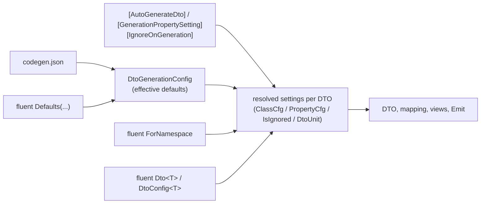

# Fluent configuration — design

Design record for the fluent configuration of `Nextended.CodeGen`. The user documentation is the
[Fluent configuration](/projects/codegen#fluent-configuration) section of the CodeGen page; this page explains *why* it looks the way it
does, what was rejected and what is planned. Status and next steps live in `CODEGEN-ROADMAP.md`.

## Goal

Today `codegen.json` and the attributes (`[AutoGenerateDto]`, `[GenerationPropertySetting]`, `[IgnoreOnGeneration]`) configure the
generators. Both stay. Added: a code configuration that

- configures a type without touching it (entities of another team, of a referenced assembly, or simply clean entities),
- changes single members (ignore, include again, rename, attributes, mapping, order),
- defines views, defaults for everything, rules per namespace and per generating assembly,
- writes additional files for one DTO or for all,
- is the same entry point for every generator (DTO now, Excel/JSON/XML structures now, TypeScript and schemas later),
- is refactoring-safe (`x => x.Number` follows a rename) and checked by the compiler and the generator,
- reads like the other fluent APIs of Nextended (`ResponseFilter<T>`), FluentValidation or EF Core.

Precedence: **json** (defaults) → **attributes** (per type/member) → **fluent** (refine). Without a fluent class nothing changes, byte for byte.

## The constraint

A source generator cannot run the user's code: the configuration class is compiled together with the code it configures, after the
generator has run. So the configuration is **read**, not executed: the generator walks the constructor body with Roslyn's operation tree
(`IOperation`), which gives the resolved method, every argument matched to its parameter (defaults and `params` filled in), constant
values (`"x"`, `const` fields, `nameof`, enum members, constant interpolations, raw strings), `typeof` and the members a lambda selects.

What is allowed is therefore a small, declarative language that happens to be C#:

| Allowed | Example |
| --- | --- |
| calls of the `Nextended.Core.CodeGen` API, chained or as statements | `Property(x => x.Number).PropertyName("No");` |
| member selectors on the lambda parameter | `Ignore(x => x.TenantId, x => x.ConcurrencyStamp)` |
| constants of any kind | `"Dto"`, `nameof(Order.Number)`, `DtoMappingStrategy.Mapperly`, `MyConsts.Ns`, `$"{MyConsts.Ns}.Contracts"`, `"""raw"""` |
| `typeof` | `Dto(typeof(Page<>), p => p.Suffix("Model"))` |
| nested lambdas | `View("Row", v => v.Ignore(x => x.Lines))`, `ForAssembly("Admin", a => a.Dto<Order>())` |
| arrays / collection expressions of constants | `Interfaces(["IEntityDto"])`, `Usings(new[] { "System.Text.Json" })` |

Anything else — a local variable, a method call that computes a value, `if`, loops, a selector like `x => x.Address.Street` or
`x => x.Name.ToUpper()`, calls of other APIs — is reported as `NCG020` on the exact expression and the statement is skipped. Nothing is
ever silently ignored. The API methods have empty bodies, so instantiating a configuration class at runtime (an assembly scan, DI) is
harmless.

## Options considered

| Option | Verdict |
| --- | --- |
| **A. Typed base classes, rules in the constructor, read with `IOperation`** (`DtoConfig<T>`, `CodeGenConfig`) | **chosen**. Same shape as `ResponseFilter<T>`, FluentValidation's `AbstractValidator<T>`, AutoMapper's `Profile`; IntelliSense, refactoring-safe selectors, compile errors for unknown members; the generator sees resolved symbols, so reading is exact and cheap |
| B. The literal sketch `ICodeGenConfig.Configure(builder)` with `gen.DtoGenConfigure<T>(s => { s.Id.Ignore(); })` | the entry point works (it is A with a method instead of a constructor), but `s.Id.Ignore()` needs an `Ignore()` extension on *every* type (it pollutes IntelliSense of all code that imports the namespace, and `s.Id` is a `Guid`, so `s.Id.PropertyName("x")` reads as if the Guid were renamed), or a generated "shape" type per entity — which the generator would have to read back from its own output. Selectors (`x => x.Id`) give the same safety without either problem |
| C. A configuration class with attributes on mirror members (`class OrderDtoConfig : DtoOf<Order> { [Ignore] Guid Id; }`, like `MetadataType`) | no execution problem, but every member is declared twice, the mirror drifts from the entity, views and defaults have no natural place, and it is the attribute model again in another file |
| D. `[assembly: CodeGenProfile(typeof(X))]` registration | adds a step without adding information: the generator finds the classes by their base type. Kept as an idea for phase 2 (choosing the profiles of a referenced config assembly) |
| E. Compile and run the configuration (load the user's assembly in the generator) | impossible for the same compilation; for referenced assemblies it would lock files in the IDE, break with every framework mismatch and execute arbitrary code inside the compiler. Rejected |
| F. Property-assignment style (`Defaults(d => { d.Namespace = "X"; })`) | readable for the json-like settings, but two styles in one API; methods everywhere keep it one language |
| G. Constructor vs. `Configure` override | the constructor matches `ResponseFilter<T>`; one way only |

## API

All types live in `Nextended.Core` (namespace `Nextended.Core.CodeGen`), next to the attributes. They are compile-time only.

```csharp
using Nextended.Core.CodeGen;
using Nextended.Core.Enums;

// one entity — like a ResponseFilter<T>
public sealed class ShipmentDtoConfig : DtoConfig<CalculatedShipment>
{
    public ShipmentDtoConfig()
    {
        GeneratedClassName("Shipment");                         // ShipmentDto
        Ignore(s => s.TenantId, s => s.ConcurrencyStamp);
        Property(s => s.WhatEver).PropertyName("Target");
        Property(s => s.Notes).PreClassString("[JsonPropertyOrder(99)]");
        MappingStrategy(DtoMappingStrategy.Mapperly);

        View("ShipmentRow", v => v                              // a second DTO of the same entity
            .Ignore(s => s.Lines, s => s.Events)
            .BaseMembersFirst()                                 // Id, CreationTime, ... before the own members
            .Order(s => s.Number, s => s.State));

        Emit("{Dto}Validator.g.cs", """
            namespace {DtoNamespace};
            public partial class {Dto}Validator : FluentValidation.AbstractValidator<{Dto}> { }
            """);
    }
}

// the whole application — defaults, groups, assemblies, other generators
public sealed class AppCodeGen : CodeGenConfig
{
    public AppCodeGen()
    {
        Defaults(d => d                                          // = codegen.json "DtoGeneration"
            .Namespace("MyApp.Contracts")
            .PropertiesToIgnore("TenantId")
            .InitializeCollections()
            .DefaultMappingSettings(m => m.Strategy(DtoMappingStrategy.Mapperly)));

        ForNamespace("MyApp.Domain.Codes", n => n.Namespace("MyApp.Contracts.Codes"));
        Dto<Currency>();                                         // no [AutoGenerateDto] needed
        Dto<Order>(o => o.Ignore(x => x.InternalNote));
        Dto(typeof(Page<>), p => p.Suffix("Model"));             // open generic types through typeof
        IgnoreType<LegacyImport>();
        ForAssembly("MyApp.Admin", a => a.Defaults(d => d.Namespace("MyApp.Admin.Contracts")));

        ExcelGeneration(e => e.SourceFile("Sources/scac_codes.xlsx").Namespace("MyApp.Scac")
            .RootClassName("ScacCode").ColumnMapping("Change indicator", "ChangeIndicator"));
    }
}
```

Aliases (owner decision 2026-11-11), the originals stay: `Name` = `PropertyName` (members only), `Attribute`/`Attributes` =
`PreClassString`, `KeepAttributes` = `KeepAttributesOnGeneratedClass` (members and DTOs). No further aliases.

Settings are **named exactly like the attribute or json property they mirror** (`Namespace`, `PropertyName`, `PreClassString`,
`MappingStrategy`, `InitializeCollections`, ...); a `bool` setting takes an optional `true`. Whatever one knows from `[AutoGenerateDto]`,
`[GenerationPropertySetting]` or `codegen.json` is a method of the same name. A test keeps both sides in sync. The only additions are
operations that have no attribute:

| Builder | Operations beyond the 1:1 settings |
| --- | --- |
| `CodeGenConfig` | `Defaults`, `ViewDefaults`, `Dto<T>()`, `Dto(typeof(...))`, `IgnoreType<T>()`, `IgnoreType(typeof(...))`, `ForNamespace`, `ForAssembly`, `ExcelGeneration`, `StructureGeneration`, `Typescript`, `Facets<T>` |
| `DtoConfig<T>` / `Dto<T>(d => ...)` | `Ignore(x => ...)`, `Include(x => ...)` (undoes `[IgnoreOnGeneration]`/`PropertiesToIgnore`), `Ignore("Name")` for enum members and names, `Property(x => ...)`, `Property(x => ..., p => ...)`, `View(name, v => ...)` (also on `Dto(typeof(...))`), `Order(x => ...)`, `OrderLast(x => ...)`, `BaseMembersFirst()`, `Emit(file, template, outputPath?)`, `Facet(x => ..., f => ...)` |
| `Facet(x => ..., f => ...)` | every `[ProvideFacet]` property, `ValueType<T>()` |
| `Property(x => ...)` | `Ignore()`, `Include()` + every `GenerationPropertySetting` |
| `Defaults(d => ...)` | every `DtoGeneration` json setting, `DefaultMappingSettings(m => ...)`, `Emit(...)` for every DTO |

## Merge model



1. **Defaults.** Fluent `Defaults` is the code form of `codegen.json`: it overrides the json values (a copy, never the loaded object) and,
   like json, stays a *default* — an attribute on a type still wins over it.
2. **Per type** (`ClassCfg`): attribute (or a fresh `AutoGenerateDtoAttribute` for a type configured only fluently) → json/fluent defaults
   for unset values (`ApplyConfigDefaults`, unchanged) → fluent `ForNamespace` rules (shorter namespace first) → fluent `Dto<T>` rules.
   `Dto<T>` only refines (owner decision 2026-11-11): `T` keeps what it inherits (its own attribute, or the base's resolved settings in
   the `AutoGenerateDerived` case, json defaults, namespace rules) and only what the fluent call sets is overridden. A type without any
   configured base starts from the attribute defaults (`Dto<T>()` opts it in).
3. **Per member** (`PropertyCfg`, `IsIgnored`): attribute setting (view-specific before general) → `PropertyNames` of the DTO → fluent.
   Fluent member rules are looked up on the view (when generating one), then on the type, then on its base types (nearest wins), then
   on the namespace rules. So a rule on a base type reaches the DTOs of derived types too (like `[IgnoreOnGeneration]`), and the more
   specific rule wins: `Include` on `Dto<Currency>` or on a view brings back a member that `Dto<Entity>` ignores (owner decision
   2026-11-11). `Ignore`/`Include` are looked up from the DTO's own type; the other member settings from the type whose DTO carries the
   member. Attribute `PropertiesToIgnore` stays per DTO (a list on a base attribute reaches only the base DTO) for backward compatibility. For a default DTO the lookup starts at the type whose DTO *declares* the member (an inherited member lives in
   the base DTO); a rule on `Dto<Derived>` for an inherited member therefore applies to the views of `Derived` and is reported (`NCG023`)
   for its default DTO.
4. **Which types**: types with `[AutoGenerateDto]` ∪ `Dto<T>()` ∪ derived types of an effective `AutoGenerateDerived`, minus
   `TypesToIgnore` and `IgnoreType<T>()` (fluent exclusion wins over the attribute).
5. **Views**: attribute views and fluent `View(...)` are the same `DtoUnit`s. A fluent view with the key of an attribute view refines it.
6. **Several profiles** are merged in order of their full type name; within one class later calls win (normal code semantics). Two
   profiles that set the same setting of the same target to different values get `NCG022`; the later one wins.

The generators keep reading `ClassCfg`, `PropertyCfg` and `DtoUnit`; those consult the merged model. No fluent class → the fluent model is
empty and every code path returns what it returned before (the golden tests and the CargonerdsApp check prove it).

## Implementation map

| Piece | Where |
| --- | --- |
| API (compile-time only) | `Nextended.Core/CodeGen/CodeGenConfig.cs`, `Nextended.Core/CodeGen/DtoConfig.cs` |
| Reader (`IOperation` walk, diagnostics, cache per compilation) | `Nextended.CodeGen/Fluent/FluentConfigReader.cs` |
| Merged model (rules per type/namespace/view/member, defaults, Excel/structure entries) | `Nextended.CodeGen/Fluent/FluentModel.cs` |
| Per type | `RoslynHelper.DefaultClassCfg` (+ `ApplyFluent`), views in `DtoGenerationSymbols.CollectViews`/`ViewCandidates`, `DtoUnit.Apply` |
| Per member | `RoslynHelper.PropertyCfg`, `DtoGenerationSymbols.MemberRules`/`IsExcluded`/`Ordered` |
| Which types | `DtoGenerationSymbols.FindTypesWithAttribute` (fluent `Dto<T>`, `AutoGenerateDerived`, `IgnoreType`) |
| Defaults, `Emit` | `DtoGenerator.Execute` / `EmittedFiles` |
| No json, other generators | `MainGenerator.ExecuteIncremental`, `GenerationContext.BasePath` |

Every fluent branch is guarded by `FluentModel.HasRules`; without a configuration class the old code paths run unchanged.

## Diagnostics

| Id | Severity | When |
| --- | --- | --- |
| `NCG020` | error | an expression the generator cannot read (variable, computed value, `if`, loop, nested selector, foreign call); the statement is skipped |
| `NCG021` | warning | a member name (`Ignore("X")`, `Order`, `Property`) that the type does not have |
| `NCG022` | warning | two profiles set the same setting to different values; the later profile (by full name) wins |
| `NCG023` | warning | a member rule on a derived type for an inherited member: the default DTO inherits the member from the base DTO, the rule applies to views only |
| `NCG024` | error | `Emit` without output path for a non-`.cs` file, or two emitted files with the same name |
| `NCG025` | warning | `Dto<T>` for a type that cannot get a DTO (struct, interface, static class, type parameter) |
| `NCG026` | warning | a call this generator version does not know (a newer Nextended.Core); update Nextended.CodeGen |
| `NCG027` | warning | `Facet(...)` rules without module initializers (before .NET 5) or without `FacetRegistry` in the referenced Nextended.Core |

The view diagnostics `NCG010`-`NCG014` apply to fluent views too.

## Additional outputs (`Emit`)

`Emit(fileName, template, outputPath = null)` writes one more file per DTO: on a type (its default DTO), on a view, in `ForNamespace`, or
in `Defaults` (every DTO, views included). Placeholders in the file name and the template:
`{Dto}`, `{Interface}`, `{DtoNamespace}`, `{DtoFullName}`, `{Source}`, `{SourceNamespace}`, `{SourceFullName}`, `{View}`.
The file goes where the DTO goes (`OutputPath` of the DTO, else of the configuration, else the compilation); `outputPath` overrides it.
A file that is not `.cs` needs a path on disk (`NCG024`), so a template never ends up compiled as C#.

Planned: one aggregated file for all DTOs (a `JsonSerializerContext`, a DI registration list) as `EmitAll(fileName, header, perDto, footer)`;
and targeting other generators (`Emit(Output.TypeScript(...))`) once they exist.

## Hooks for the other generators

`ExcelGeneration(e => ...)` and `StructureGeneration(s => ...)` add an entry exactly like one in `ExcelGenerations` /
`StructureGenerations` of the json (1:1 settings; `ColumnMapping(header, property)` and `PropertyTypeOverride(property, type)` fill the
dictionaries). Relative paths resolve against the json file, or against the project directory when there is no json.
The TypeScript generation follows that pattern: `Typescript(t => ...)` on `CodeGenConfig` (an entry of the json `Typescript` list,
read by `TypescriptGenerationContext`) and `Typescript(x => ...)` on `DtoConfig<T>` (per type, into `FluentModel.TypescriptTypes`).
A future generator (JSON schema, message-protocol classes) adds a method on `CodeGenConfig` and a section on the per-type
builder (`d.TypeScript(t => t.Name(...))`), read by the same reader into the same model — the reader is a generic "settings by name onto
the generator's config object" walker plus a handful of operations.

## View defaults (10.1.61)

`ViewDefaults(v => ...)` is one `FluentTypeRules` without a type. For every view `CollectViews` builds the view's effective rules: the
defaults' settings that neither the view's `[AutoGenerateDto]` (its named arguments) nor its `View(...)` sets, then the view's own
settings, members and `Emit`s, then the defaults' `Emit`s. Member rules of the defaults are looked up last (after the view, the type
chain and the namespace rules), so a type's `Include` beats a default `Ignore`. Rejected: putting view defaults into `Defaults(...)` (that
is `codegen.json`, whose settings are attribute-level defaults and reach default DTOs too).

## Facets (10.1.61)

`[ProvideFacet]` is read by reflection at run time (`FacetBuilder`, and apps' own readers), not by the generator. Options for a code
registration:

| Option | Verdict |
| --- | --- |
| **Generated registration**: the reader turns `Facet(...)` into C# expressions, the generator adds `NextendedFacetRegistrations.g.cs` with a `[ModuleInitializer]` calling `FacetRegistry.Register(typeof(T), "Member", f => { f.Label = ...; })` | **chosen**. No app code runs at startup, the configuration stays declarative like the rest, the values are exactly the attribute's. `FacetRegistry.GetFacets` runs the module initializers of the type's assemblies (`RuntimeHelpers.RunModuleConstructor`) before reading, so the registration is there although reflection over a type runs no code of its module |
| Runtime registry filled by executing the configuration class (`new AppCodeGen()`) | the API methods are empty and the nested lambdas (`Dto<T>(d => ...)`) are never invoked; executing them would mean a second, runtime implementation of the whole API, and the app would have to construct the class |
| An assembly attribute per facet, found by scanning loaded assemblies | only loaded assemblies are seen; same timing problem without a trigger |

Precedence like the rest: the attribute's values, then the fluent values (only those set), base type before derived type. The registry is
keyed by type (generic definitions for generic types) and member name; `FacetBuilder` caches per type and rebuilds when the registry's
`Version` changes.

## Stale files (10.1.61)

`DeleteStaleFiles` (json `DtoGeneration`, fluent `Defaults`): after all sub-generators ran, `MainGenerator` deletes in every folder the DTO
generator wrote to in this run the top-level `.cs` files that no generator of the run wrote and whose first line is the DTO generator's
`// <auto-generated/>`. A manifest (like the TypeScript writer's) was considered: it would also be safe for folders shared by several
projects, but it misses the files written before the switch was turned on (the common case: leftovers of earlier versions) and adds a
file to every output folder. The header line identifies the generator's files without one; the documented rule is one output folder per
project. Skipped while the compilation has syntax errors or the fluent model has errors (IDE keystrokes), and when the DTO generator
threw.

## Per assembly and per namespace

- `ForAssembly("MyApp.Admin", a => ...)` holds rules (the same `CodeGenConfig` language) that apply only when the generating project's
  assembly name matches. With a shared configuration file (linked into several projects, or the phase 2 config project) one class
  describes all of them. Rules for other assemblies are still checked for diagnostics.
- `ForNamespace("MyApp.Domain.Codes", n => ...)` applies type settings and member rules by name to every generated type in that namespace
  or below it.

## Phase 2: one central configuration project

Goal: a `MyApp.CodeGen` project holds the profiles; `Domain`, `Contracts`, `Frontend` reference it and generate from it.

Design: when the generator runs in a project that contains profiles, it serializes the *read* fluent specification (type keys, setting
names, constant values — already strings, see Incrementality) into an embedded resource / an assembly-level attribute
(`[assembly: NextendedCodeGenSpec("<json>")]`) of that project. Consuming projects find it in their references
(`compilation.References` → `IAssemblySymbol.GetAttributes()`), merge it before their own profiles (own profiles win), and resolve type
keys against their compilation. `ForAssembly` then selects per consumer. Not implemented yet: it needs the symbol-free spec first, and
the same-compilation path proves the semantics first.

## Incrementality and IDE performance

- The generator today combines the whole `Compilation` and runs on every change; the fluent reader does not make that worse:
  without `Nextended.Core.CodeGen.CodeGenConfig` in the compilation (every project on an older Core, CargonerdsApp today) it returns
  immediately; otherwise it only binds the constructors of the profile classes, found by their declared base types.
- The read model is cached per `Compilation` (shared by the main generator and the DTO generator).
- The model keys types by their display string and members by name, so it can become a symbol-free, equatable specification. The next
  step (with TypeScript M3) is a real pipeline: `SyntaxProvider` for profile classes → equatable spec → `Combine` with the attribute data,
  so a keystroke in an unrelated file does not re-read profiles nor regenerate.

## PoC findings (CoShipee on 10.1.55) and how the fluent API covers them

| Finding | Fluent answer |
| --- | --- |
| member order of views (ABP lists base members first) | `View(..., v => v.BaseMembersFirst())`, `Order(x => ..., ...)` and `OrderLast(x => ...)` (10.1.61) — implemented |
| `Namespace(...).OutputPath(...)` repeated on every view | `ViewDefaults(v => ...)` (10.1.61) |
| facets injected into a copied model | `Facets<T>(f => f.Facet(...))` (10.1.61) |
| views with extra members (shadow keys like `QuotationId`) | planned: `v.AddMember<Guid>("QuotationId")` (DTO-only member, not mapped, `[MapperIgnoreTarget]` with Mapperly) |
| changing a member's type (`Guid` → `Guid?` with a converter) | planned: `Property(x => x.Id).Type<Guid?>()` plus `MapWith(...)` naming a static converter method — needs mapping support in both strategies |
| attributes of DTO-typed members land on the explicit interface implementation | open point (independent of the fluent API) |
| view type in a generic constraint not fully qualified | open bug (independent of the fluent API) |
| a view of an abstract type merging several subtypes | out of scope for views; documented |
